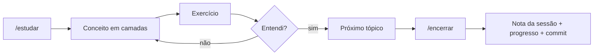

<picture>
  <source media="(prefers-color-scheme: dark)" srcset="assets/logo-dark.svg">
  
</picture>

**Prompt + test.** Workspace de estudo de Inteligência Artificial, DevOps, cloud e QA, dos fundamentos ao avançado, com um tutor de IA e só fontes gratuitas.


## Objetivo

Ganhar habilidade prática e aprender os fundamentos principais de IA, do básico ao avançado. É um plano único de 21 módulos, cada um de uma área: Base, IA, DevOps (Linux, redes, Docker, CI/CD, observabilidade), Cloud (AWS, Terraform, Kubernetes) e QA. Os módulos se alternam para que cada um prepare o seguinte, e o último aplica tudo em qualidade de software.

Três regras guiam o caminho:

- **Um projeto por módulo.** Só avanço quando o projeto do módulo está pronto, no meu ritmo e sem prazo fixo.
- **Cursos oficiais e gratuitos**, como Anthropic Academy, OpenAI Academy e Google.
- **Tudo registrado.** Cada sessão vira uma nota e um commit.

## Progresso

Cada módulo tem um projeto próprio e só termina quando ele está pronto. A coluna "Tópicos" mostra o tamanho de cada assunto, com a contagem entre parênteses: são 177 no total.

| Módulo | Área | Tema | Tópicos | Status |
| --- | --- | --- | --- | --- |
| 1 | Base | **Base técnica** | (9) Terminal básico · Python do zero · Git e GitHub · Python para IA · HTTP e APIs · Docker · SQL básico · Jupyter Notebooks · TypeScript (opcional) | Em andamento (1 de 9) |
| 2 | DevOps | **Linux e terminal** | (8) WSL2 e Bash · Sistema de arquivos · Permissões · Processos · Pacotes · Logs · SSH · Scripts Bash e cron | Não iniciado |
| 3 | IA | **Prompt e uso avançado** | (13) Como um LLM funciona · Modelo, ferramenta e agente · Famílias de modelos · Anatomia do prompt · Zero-shot e few-shot · Chain-of-thought · Encadeamento de prompts · Tags XML e saída em JSON · Grounding e citações · Autocrítica · Meta-prompting · Recursos de Claude, ChatGPT e Gemini · Uso responsável | Não iniciado |
| 4 | DevOps | **Redes** | (7) TCP/IP e sub-redes · Portas · DNS · HTTP e HTTPS · Load balancer · Firewall · Diagnóstico | Não iniciado |
| 5 | IA | **APIs de modelos** | (11) APIs da Anthropic, OpenAI e Gemini · SDKs e chaves · Streaming · Saídas estruturadas · Tool use · Entradas multimodais · Raciocínio estendido · Caching e batch · Custo, limites e retries · Interfaces com Streamlit e Gradio · Bibliotecas multiprovedor | Não iniciado |
| 6 | DevOps | **Git e scripting** | (6) Git do dia a dia · GitHub e pull requests · Python para automação · Testes com pytest · Bash ou Python · API com FastAPI | Não iniciado |
| 7 | IA | **RAG e dados** | (10) Embeddings · Ingestão · Chunking · Bancos vetoriais · Busca híbrida e reranking · Técnicas avançadas · Agentic RAG · Contexto longo x RAG · Avaliação de RAG · LlamaIndex e LangChain | Não iniciado |
| 8 | DevOps | **Docker** | (6) Imagens e containers · Dockerfile · Boas práticas · Volumes e redes · docker-compose · Segurança da imagem | Não iniciado |
| 9 | IA | **Agentes, MCP e OpenClaw** | (12) Loop agêntico · Workflow x agente · Planejamento e ReAct · Memória e contexto · Multiagentes · Humano no circuito · Computer use · MCP · A2A · Skills · Frameworks (Claude Agent SDK, OpenAI Agents SDK, LangGraph, CrewAI) · OpenClaw | Não iniciado |
| 10 | DevOps | **CI/CD com GitHub Actions** | (6) CI x CD · Workflows em YAML · Testes no pipeline · Build e publicação · Segredos · Boas práticas | Não iniciado |
| 11 | IA | **Agentes de código e automação** | (7) Claude Code a fundo · Codex, Cursor, Copilot e Gemini CLI · Boas práticas · Vibe coding x engenharia · n8n · Make, Zapier e Power Automate · Integrações e agendamento | Não iniciado |
| 12 | Cloud | **AWS** | (7) Conta e custo · IAM · VPC · EC2 · S3 · RDS · AWS CLI | Não iniciado |
| 13 | Cloud | **Terraform** | (8) Infraestrutura como código · Ciclo `plan` e `apply` · HCL · State remoto · Módulos Terraform · Segurança · Terraform no CI · OpenTofu | Não iniciado |
| 14 | IA | **Evals e confiabilidade** | (9) Golden datasets · Tipos de avaliação e LLM como juiz · Métricas · Regressão de prompt · Avaliação de agentes · Tracing · Guardrails · Prompt injection e red teaming · Benchmarks | Não iniciado |
| 15 | Cloud | **Kubernetes** | (7) Por que existe · Cluster local · Pod, Deployment e Service · ConfigMap e Secret · Probes e recursos · Operação e rollback · Helm | Não iniciado |
| 16 | DevOps | **Observabilidade e SRE** | (8) Métricas, logs e traces · Prometheus · Grafana · Logs estruturados · Alertas · SLI, SLO e SLA · Incidentes e postmortem · OpenTelemetry | Não iniciado |
| 17 | IA | **Fundamentos de ML e LLMs por dentro** | (12) Álgebra linear, cálculo e probabilidade · Regressão e árvores · Perda, gradiente e overfitting · Métricas de ML · Redes neurais e backpropagation · PyTorch · CNN e RNN · Tokenização e atenção · Transformer · Pré-treino, SFT e RLHF · Leis de escala e MoE · Interpretabilidade | Não iniciado |
| 18 | IA | **Modelos abertos e fine-tuning** | (11) Hugging Face · Famílias abertas · Rodar local e quantização · Servir com vLLM · Quando fazer fine-tuning · Dataset de instruções · LoRA e QLoRA · Avaliação, destilação e DPO · Servir com FastAPI e Docker · Filas, cache e versionamento · Monitoramento e rollback | Não iniciado |
| 19 | IA | **Multimodal** | (4) Visão · Geração de imagem · Voz · Vídeo | Não iniciado |
| 20 | IA | **Segurança, ética e regulação** | (4) Segurança de sistemas com LLM · Alinhamento · Ética · Regulação (LGPD, AI Act) | Não iniciado |
| 21 | QA | **IA aplicada a QA** | (12) Casos de teste a partir de requisitos · Revisão de requisitos · Dados sintéticos · Automação com agentes · Playwright MCP · Análise de falhas e flaky · Testes de API por contrato · Agentes de QA no CI · Testes de chatbots, RAG e agentes · Testes não determinísticos · Red teaming · Qualidade em produção | Não iniciado |

O ritmo e as sessões estão em [progresso.md](progresso.md); o plano completo, com o detalhe de cada tópico e os projetos, em [plano.md](plano.md).

## Como funciona

O tutor é o próprio Claude Code. O arquivo [CLAUDE.md](CLAUDE.md) define como ele ensina, e ele o lê sozinho ao abrir a pasta. Cada sessão segue o mesmo ciclo:



### Comandos do tutor

| Comando | O que faz |
| --- | --- |
| `/estudar [minutos]` | Começa a sessão do ponto certo |
| `/onde-paramos` | Resumo rápido do progresso |
| `/me-testa [tópico]` | Quiz curto sobre o tópico |
| `/revisao` | Revisão quinzenal do que aprendi |
| `/encerrar` | Registra a sessão, atualiza o progresso e faz o commit |

## Estrutura

```text
PromTest/
├── CLAUDE.md          instruções do tutor (lidas pelo Claude Code)
├── plano.md           o plano único: 21 módulos, ritmo e projetos
├── progresso.md       onde parei, ritmo, roteiro, tópicos, registro
├── duvidas.md         dúvidas abertas e tópicos para revisar
├── sessoes/           uma nota por sessão (AAAA-MM-DD.md)
├── projetos/          um projeto por módulo (modulo-NN-nome/, painel-testes/)
├── templates/         modelos de sessão e de README
├── conteudo/          LinkedIn e Substack: guia, pautas, métricas, posts
├── docs/
│   ├── SETUP.md       instalação, extensões, Obsidian, conectores
│   └── PRD-tutor.md   como o tutor funciona
└── .claude/skills/    comandos /estudar /encerrar /onde-paramos /me-testa /revisao
```

## Quer usar o método?

Não precisa colar prompt nenhum: o `CLAUDE.md` é o prompt. Escolha uma das opções abaixo.

<details>
<summary><strong>Opção A: terminal com Claude Code</strong> (exige plano pago do Claude)</summary>

1. Instale o que precisa: [docs/SETUP.md](docs/SETUP.md) (no mínimo Git, VS Code e Claude Code).
2. Baixe o repositório e abra o tutor:

   ```bash
   git clone https://github.com/mauriciofeoli/promtest.git PromTest
   cd PromTest
   claude
   ```

3. Confira se o tutor leu tudo: digite `/onde-paramos`.
4. Comece: `/estudar 60` (60 = minutos disponíveis) ou escreva "vamos estudar".
5. Para parar, só se despeça ("por hoje é isso"). O tutor salva o progresso e faz o commit sozinho.

Nas próximas vezes, é só `cd PromTest` e `claude`.

Para começar do zero com o seu próprio progresso, zere `progresso.md`, `duvidas.md` e a pasta `sessoes/`.

</details>

<details>
<summary><strong>Opção B: claude.ai, sem instalar nada</strong> (plano gratuito)</summary>

1. Crie um Projeto "PromTest" no claude.ai.
2. Cole nas instruções do Projeto o conteúdo de [docs/PRD-tutor.md](docs/PRD-tutor.md).
3. Abra uma conversa no Projeto e escreva "vamos estudar".

Nessa opção o progresso fica no próprio Projeto. Quando passar para a opção A, peça ao tutor para copiar esse progresso para `progresso.md`.

</details>
