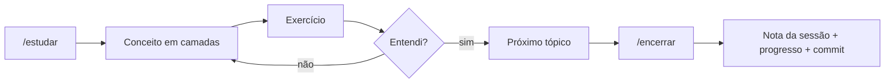

<picture>
  <source media="(prefers-color-scheme: dark)" srcset="assets/logo-dark.svg">
  
</picture>

**Prompt + test.** Workspace de estudo de Inteligência Artificial, dos fundamentos ao avançado, com um tutor de IA e só fontes gratuitas.


## Objetivo

Ganhar habilidade prática e aprender os fundamentos principais de IA, do básico ao avançado. A última fase aplica o que foi aprendido em qualidade de software.

Três regras guiam o caminho:

- **Um projeto por fase.** Só avanço quando o projeto da fase está pronto.
- **Cursos oficiais e gratuitos**, como Anthropic Academy, OpenAI Academy e Google.
- **Tudo registrado.** Cada sessão vira uma nota e um commit.

## Progresso

| Fase | Tema | Status |
| --- | --- | --- |
| 0 | Base técnica | Em andamento |
| 1 | Prompt e uso avançado | Não iniciada |
| 2 | APIs de modelos | Não iniciada |
| 3 | RAG e dados | Não iniciada |
| 4 | Agentes, MCP e OpenClaw | Não iniciada |
| 5 | Agentes de código e automação | Não iniciada |
| 6 | Evals e confiabilidade | Não iniciada |
| 7 | Fundamentos de ML e LLMs por dentro | Não iniciada |
| 8 | Modelos abertos e fine-tuning | Não iniciada |
| 9 | Multimodal | Não iniciada |
| 10 | Segurança, ética e regulação | Não iniciada |
| 11 | IA aplicada a QA | Não iniciada |

O detalhe de cada fase, tópico e sessão está em [progresso.md](progresso.md) e o plano completo em [plano.md](plano.md).

## Como funciona

O tutor é o próprio Claude Code. O arquivo [CLAUDE.md](CLAUDE.md) define como ele ensina, e ele o lê sozinho ao abrir a pasta. Cada sessão segue o mesmo ciclo:



### Comandos do tutor

| Comando | O que faz |
| --- | --- |
| `/estudar [minutos]` | Começa a sessão do ponto certo |
| `/onde-paramos` | Resumo rápido do progresso |
| `/me-testa [tópico]` | Quiz curto sobre o tópico |
| `/revisao` | Revisão quinzenal e ajuste de ritmo |
| `/encerrar` | Registra a sessão, atualiza o progresso e faz o commit |

## Estrutura

```text
PromTest/
├── CLAUDE.md          instruções do tutor (lidas pelo Claude Code)
├── plano.md           o plano completo: 12 fases, cursos, projetos
├── progresso.md       onde parei, fases, tópicos, registro
├── duvidas.md         dúvidas abertas e tópicos para revisar
├── sessoes/           uma nota por sessão (AAAA-MM-DD.md)
├── projetos/          um projeto por fase (fase-N-nome/)
├── templates/         modelos de sessão e de README
├── conteudo/          LinkedIn e Substack: guia, pautas, métricas, posts
├── docs/
│   ├── SETUP.md       instalação, extensões, Obsidian, conectores
│   └── PRD-tutor.md   como o tutor funciona
└── .claude/skills/    comandos /estudar /encerrar /onde-paramos /me-testa /revisao
```

## Quer usar o método?

Não precisa colar prompt nenhum: o `CLAUDE.md` é o prompt. Escolha uma das opções abaixo.

<details>
<summary><strong>Opção A: terminal com Claude Code</strong> (exige plano pago do Claude)</summary>

1. Instale o que precisa: [docs/SETUP.md](docs/SETUP.md) (no mínimo Git, VS Code e Claude Code).
2. Baixe o repositório e abra o tutor:

   ```bash
   git clone https://github.com/mauriciofeoli/promtest.git PromTest
   cd PromTest
   claude
   ```

3. Confira se o tutor leu tudo: digite `/onde-paramos`.
4. Comece: `/estudar 60` (60 = minutos disponíveis) ou escreva "vamos estudar".
5. Para parar, só se despeça ("por hoje é isso"). O tutor salva o progresso e faz o commit sozinho.

Nas próximas vezes, é só `cd PromTest` e `claude`.

Para começar do zero com o seu próprio progresso, zere `progresso.md`, `duvidas.md` e a pasta `sessoes/`.

</details>

<details>
<summary><strong>Opção B: claude.ai, sem instalar nada</strong> (plano gratuito)</summary>

1. Crie um Projeto "PromTest" no claude.ai.
2. Cole nas instruções do Projeto o conteúdo de [docs/PRD-tutor.md](docs/PRD-tutor.md).
3. Abra uma conversa no Projeto e escreva "vamos estudar".

Nessa opção o progresso fica no próprio Projeto. Quando passar para a opção A, peça ao tutor para copiar esse progresso para `progresso.md`.

</details>
